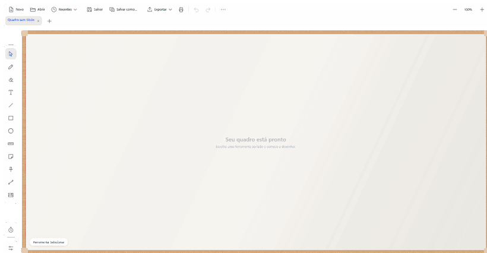
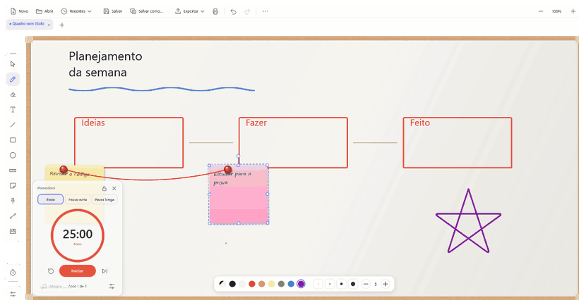
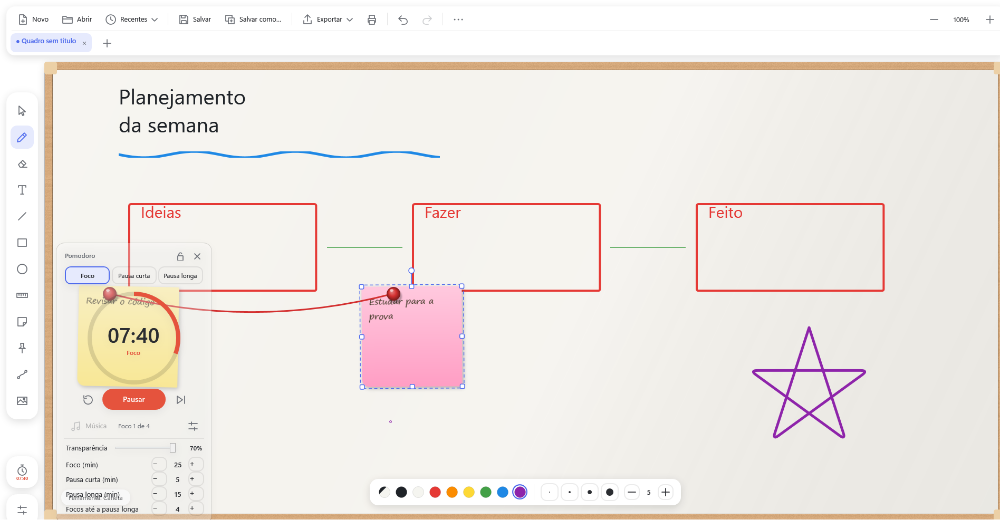

# 🧑‍🏫 Whiteboard Simulator

> **Um quadro branco de verdade, dentro do seu computador — com um Pomodoro flutuante para você manter o foco enquanto desenha, escreve e organiza ideias.**




## 💡 A ideia

O Whiteboard Simulator **simula um quadro branco real**. Não é uma tela infinita de rabiscos: é um **quadro com moldura, bordas e limites**, como o que você tem na parede da sala de aula ou do escritório.

- 🪟 **O quadro respeita as bordas.** Ele não rola para o infinito. Você escreve dentro da superfície, como num quadro de verdade (com zoom, dá para chegar perto dos detalhes, mas a borda nunca "foge").
- 🖍️ **Ferramentas de quadro:** caneta, borracha que apaga só onde toca, régua, post-its, alfinetes com linhas de ligação — tudo com cara e comportamento de objetos físicos.
- 🪵 **Moldura e superfície à escolha:** moldura de madeira ou metal; superfície de quadro branco, lousa preta, lousa verde ou veludo verde.
- 📌 **Post-its e alfinetes:** o alfinete colocado sobre um post-it fica preso a ele, e as linhas de ligação conectam alfinetes.

## ⏱️ Pomodoro integrado (destaque)

O diferencial do projeto: **um timer Pomodoro nativo, integrado ao quadro**, para quem estuda, planeja ou dá aula usando o quadro e quer manter o ritmo foco/pausa **sem abrir outro aplicativo**.



- **Um clique no botão do relógio** (ao lado do botão de aparência) abre o painel.
- **Foco, Pausa curta e Pausa longa**, com a pausa longa vindo automaticamente depois de N focos (padrão: 25 / 5 / 15 min, 4 focos por ciclo — tudo ajustável e salvo).
- **Janela flutuante, sempre no topo:** fica visível mesmo quando você está em outro programa, e **pode ser arrastada para qualquer lugar da tela**.
- **🔒 Travar:** o cadeado bloqueia o movimento e os botões, para evitar cliques acidentais enquanto o timer roda.
- **Fundo com transparência ajustável** (de sólido a bem translúcido), para enxergar o quadro por trás. O texto e o anel continuam nítidos.
- **Continua correndo com o painel fechado:** o botão do relógio mostra o tempo restante; ao terminar uma sessão toca um som e avisa na barra de status. A próxima sessão **não** inicia sozinha, você decide quando continuar.
- Medido pelo relógio do sistema, então **não atrasa** mesmo com a janela ocupada.
- O ícone de música já está reservado no painel (🎵 em breve).



## ✨ Recursos

| | |
|---|---|
| **Desenho** | Caneta (cor e espessura), borracha parcial, linha, quadrado, círculo, régua horizontal/vertical |
| **Texto** | Texto formatado por trecho (negrito, itálico, sublinhado, cor, tamanho), 15 fontes |
| **Organização** | Post-its coloridos, alfinetes, linhas de ligação, imagens, camadas (para frente/trás) |
| **Abas** | Vários quadros abertos ao mesmo tempo |
| **Arquivos** | Salvar/abrir `.wboard`, recentes e favoritos, **salvamento automático com recuperação** após falhas |
| **Exportar** | PNG, PDF, impressão e pacote compartilhável `.wbpack` |
| **Desfazer/refazer** | `Ctrl+Z` / `Ctrl+Y` com histórico de até 200 passos |
| **Visual** | Tema claro/escuro, aparência do quadro, ícone na bandeja do Windows |

### ⌨️ Atalhos

| Atalho | Ação |
|---|---|
| `Ctrl+Z` / `Ctrl+Y` (ou `Ctrl+Shift+Z`) | Desfazer / refazer |
| `Ctrl+N` / `Ctrl+T` | Novo quadro / nova aba |
| `Ctrl+O` / `Ctrl+S` / `Ctrl+Shift+S` | Abrir / salvar / salvar como |
| `Ctrl+P` | Imprimir |
| `Ctrl+W`, `Ctrl+Tab` | Fechar aba, próxima aba |
| `Ctrl+D` | Duplicar seleção |
| `V P E T L R O G N A C I` | Selecionar, caneta, borracha, texto, linha, quadrado, círculo, régua, post-it, alfinete, ligação, imagem |
| `+` / `-` | Aumentar/diminuir a espessura da caneta ou o tamanho da borracha |
| Setas (`Shift` = 10×) | Mover a seleção |
| `Ctrl` + roda do mouse | Zoom |
| `F11` | Tela cheia |
| `Esc` | Cancelar a ação atual |

## 📥 Download

Baixe na página de **[Releases](https://github.com/Luc4sL4mou/whiteboard-simulator/releases/latest)**:

| Arquivo | Para quem | Tamanho |
|---|---|---|
| `WhiteboardSimulator-Setup-<versão>.exe` | **Recomendado.** Instalador: cria atalhos e, se faltar, instala o .NET 8 Desktop Runtime sozinho. | ~4 MB |
| `WhiteboardSimulator-<versão>-win-x64-portable.exe` | Executável único com o .NET embutido. Não instala nada: é só abrir. | ~156 MB |

> O Windows pode mostrar o aviso do SmartScreen ("editor desconhecido"), porque o executável não é assinado digitalmente. Clique em **Mais informações → Executar assim mesmo**. O código-fonte completo está aqui para você conferir.

## 🧰 Requisitos

**Para usar**
- Windows 10 (1809 ou mais novo) ou Windows 11, 64 bits (x64)
- Instalador: [.NET 8 Desktop Runtime](https://dotnet.microsoft.com/download/dotnet/8.0) (o próprio instalador baixa e instala se faltar, precisa de internet só nesse caso)
- Versão portátil: nada além do Windows
- ~160 MB de espaço em disco para a versão portátil

**Para compilar**
- [.NET SDK 8](https://dotnet.microsoft.com/download/dotnet/8.0) ou mais novo
- (Opcional) [Inno Setup 6](https://jrsoftware.org/isinfo.php) para gerar o instalador

## 🛠️ Compilar e executar

```powershell
git clone https://github.com/Luc4sL4mou/whiteboard-simulator.git
cd whiteboard-simulator
dotnet run
```

**Executável único com o .NET embutido (~156 MB):**

```powershell
dotnet publish -c Release -r win-x64 --self-contained true -p:PublishSingleFile=true -p:IncludeNativeLibrariesForSelfExtract=true -o publish
```

**Instalador:**

```powershell
winget install JRSoftware.InnoSetup
powershell -File installer\build-installer.ps1 -Version 0.2.0
```

O resultado fica em `installer\output\`. O instalador também aceita instalação silenciosa (`/VERYSILENT`) e, sem administrador, `/CURRENTUSER` (nesse modo não instala o runtime).

## 🧪 Testes

Há um autoteste que dirige o app por dentro (eventos de mouse sintéticos, atalhos de teclado reais, Pomodoro, limites do quadro...). Só existe na versão Debug:

```powershell
$env:WBS_DATA_DIR = "$env:TEMP\wbs-test"      # pasta isolada: nunca mexe nos seus dados reais
dotnet build -c Debug
bin\Debug\net8.0-windows\WhiteboardSimulator.exe --selftest "$env:TEMP\wbs-out"
# o relatório fica em %TEMP%\wbs-out\relatorio.txt
```

Os GIFs deste README foram gerados pelo gravador de demonstração (`--demo <pasta>`, também só em Debug), que roteiriza as cenas sem usar o mouse real.

## 🔐 Privacidade e segurança

- **Sem telemetria, sem contas, sem rede.** O app não faz nenhuma conexão de internet. (Só o *instalador*, e apenas se faltar o .NET, baixa o runtime direto da Microsoft por HTTPS.)
- Seus quadros ficam onde você salvar. Preferências e cópias de recuperação ficam em `%AppData%\WhiteboardSimulator`.
- Arquivos `.wboard`/`.wbpack` são lidos como dados (JSON), nunca executados.
- Não há segredos, chaves ou credenciais neste repositório.

## 🗂️ Estrutura

- `Models/` — elementos do quadro (posição, tamanho, rotação), documento e aparência
- `ViewModels/` — `MainViewModel`, `BoardViewModel` (um por aba), `PomodoroViewModel`, estado das ferramentas
- `Controls/` — `BoardCanvas` (mouse e ferramentas) e `ElementView` (desenho de cada elemento)
- `Helpers/` — arquivos, recuperação, exportação, desfazer/refazer
- `PomodoroWindow.xaml` — janela flutuante do Pomodoro
- `installer/` — script do instalador (Inno Setup)
- `SelfTest.cs`, `DemoRecorder.cs` — autoteste e gravador de demonstração (só Debug)

## 🙏 Créditos e agradecimentos

- **[Microsoft .NET e WPF](https://dotnet.microsoft.com/)** — a base de todo o app (MIT).
- **[Inno Setup](https://jrsoftware.org/isinfo.php)**, de Jordan Russell e Martijn Laan — o instalador.
- **[FFmpeg](https://ffmpeg.org/)** — usado para montar os GIFs deste README.
- **[Shields.io](https://shields.io/)** — os selos no topo.
- O método Pomodoro foi criado por **Francesco Cirillo** no fim dos anos 1980.
- As fontes do quadro (Segoe UI, Segoe Print, Calibri, etc.) são fontes do próprio Windows. Nenhuma é redistribuída aqui.
- Desenvolvido com a ajuda de **[Claude Code](https://claude.com/claude-code)**, da Anthropic.

Obrigado a quem testar, abrir uma *issue* ou sugerir melhorias. 💙

## 📄 Licença

[MIT](LICENSE) © 2026 Luc4sL4mou
